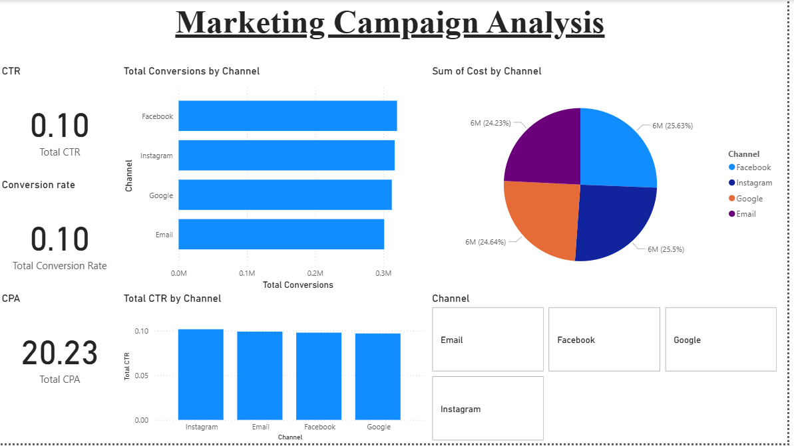

# 📊 Sales & Marketing Analytics Dashboard

## 🔍 Overview

This project analyzes sales performance and marketing campaign effectiveness using Excel and Power BI to derive actionable business insights.

---

## 🛠 Tools Used

* Excel (Data Cleaning & KPI Calculation)
* Power BI (Data Visualization & Dashboard)

---

## 📂 Datasets

* Sales dataset (~9,000 records)
* Marketing campaign dataset (~5,000 records)

---

## 📊 Sales Insights

* Identified total revenue of ~$2M+ with the West region contributing the highest share
* Technology category emerged as the top-performing segment
* Detected underperforming regions requiring strategic improvement

---

## 📢 Marketing Insights

* Evaluated campaign performance using CTR, Conversion Rate, and CPA
* Identified high-performing channels with better conversion efficiency
* Recommended budget reallocation to optimize ROI

---

## 📈 Key Features

* Interactive dashboards with filters (Region, Category, Channel)
* KPI tracking for sales, profit, CTR, and conversions
* Clear visualization of trends and performance metrics

---

## 📷 Dashboard Preview

---

## 🚀 Outcome

This project demonstrates strong analytical skills in data cleaning, KPI calculation, and business insight generation using real-world datasets.

## Repository files

### assets/

- [Marketing.png](assets/Marketing.png)
- [Sales analysis.png](assets/Sales%20analysis.png)

### powerbi/

- [Marketing Campaign.pbix](powerbi/Marketing%20Campaign.pbix)
- [Sales Performance.pbix](powerbi/Sales%20Performance.pbix)

### data/

- [marketing_dataset.xlsx](data/marketing_dataset.xlsx)
- [sales_dataset.xlsx](data/sales_dataset.xlsx)

